# EEGNet Architecture Playground

A local, stateful platform for learning and experimenting with **EEGNet** (Lawhern et al., 2018). Upload EEG,
define an evaluation protocol, build a preprocessing pipeline, configure the architecture, train it, and then look
inside the trained model: its learned kernels, the arithmetic of every convolution, and how each layer transforms a
trial. You can also break the architecture to see what changes, and compare experiments under matched protocols.

Every number in the interface comes from real computation: actual preprocessing, actual PyTorch training, forward
hooks on saved checkpoints, and metrics on held-out data. Nothing is simulated, and EEG data never leave your machine.


---

## Contents

**Getting started**

1. [Prerequisites](#prerequisites)
2. [Installation](#installation)
3. [Starting the app](#starting-the-app)
4. [Configuration (environment variables)](#configuration-environment-variables)
5. [Running the tests](#running-the-tests)
6. [Troubleshooting](#troubleshooting)

**Using the platform**

7. [Features](#features)
8. [How it is built](#how-it-is-built)
9. [The workflow](#the-workflow)
10. [Importing datasets](#importing-datasets)
11. [Configuring preprocessing](#configuring-preprocessing)
12. [Split strategies and what they measure](#split-strategies-and-what-they-measure)
13. [Training and cross-validation](#training-and-cross-validation)
14. [Inspecting a trained model](#inspecting-a-trained-model)
15. [Comparing experiments](#comparing-experiments)
16. [Exporting results](#exporting-results)

**Reference**

17. [API overview](#api-overview)
18. [Scientific limitations and known constraints](#scientific-limitations-and-known-constraints)

---

## Prerequisites

- **[uv](https://docs.astral.sh/uv/)** ≥ 0.5. It installs Python 3.11 automatically if needed.
- **Node.js** ≥ 20 and npm (tested with Node 24).
- *Optional:* an NVIDIA GPU with a recent driver for CUDA training. The CUDA build targets CUDA 13.0 wheels
  (`torch 2.14.1+cu130`). Everything also runs on the CPU.
- About 6 GB of free disk space for the CUDA build of PyTorch, or about 1 GB for the CPU build.


## Installation

The diagram shows the full installation path; the commands follow.

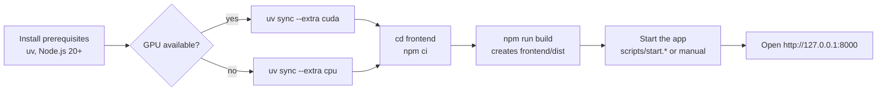

```bash
# 1. Backend (pick ONE PyTorch build; both are pinned in backend/uv.lock)
cd backend
uv sync --extra cuda        # NVIDIA GPU
# uv sync --extra cpu       # CPU only

# 2. Frontend
cd ../frontend
npm ci                      # exact versions from package-lock.json
npm run build               # produces frontend/dist, served by the backend
```

> **Important:** PyTorch is an *extra*, so always pass the same `--extra cuda|cpu` to every `uv sync` and `uv run`
> command. Otherwise uv may remove torch from the environment.

If your system drive is short on space, point uv's cache elsewhere first, e.g. `set UV_CACHE_DIR=E:\uv-cache`
(PowerShell: `$env:UV_CACHE_DIR="E:\uv-cache"`).


## Starting the app

**One command** (installs pinned dependencies, builds the frontend once and serves everything on one port):

```powershell
scripts\start.ps1                 # Windows; auto-detects CUDA via nvidia-smi
scripts\start.ps1 -Torch cpu      # force the CPU build
```
```bash
scripts/start.sh                  # macOS / Linux / Git Bash  (scripts/start.sh cpu  to force CPU)
```

Then open **http://127.0.0.1:8000**.

**Manually:**

```bash
cd frontend && npm run build
cd ../backend && uv run --extra cuda python -m app.main      # http://127.0.0.1:8000
```

**Development mode** (hot reload; the Vite dev server proxies `/api` to the backend):

```bash
cd backend  && uv run --extra cuda uvicorn app.main:app --host 127.0.0.1 --port 8000 --reload
cd frontend && npm run dev                                       # http://127.0.0.1:5173
```

(`scripts\dev.ps1` opens both in separate windows.) Interactive API docs are at http://127.0.0.1:8000/docs.

### What happens at start-up

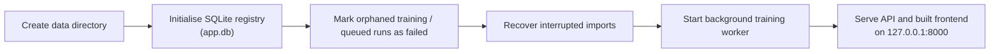


## Configuration (environment variables)

All settings are optional. See `.env.example`. A `.env` file at the project root is read automatically.

| Variable | Default | Meaning |
|---|---|---|
| `EEGNET_DATA_DIR` | `./data` | Data store (relative paths are resolved from the project root) |
| `EEGNET_HOST` / `EEGNET_PORT` | `127.0.0.1` / `8000` | Bind address (localhost only by default) |
| `EEGNET_MAX_UPLOAD_MB` | `1024` | Size limit of a single-request upload (legacy upload endpoint) |
| `EEGNET_MAX_IMPORT_MB` | `20480` | Size limit of the files staged by one folder / multi-file import |
| `EEGNET_IMPORT_ROOTS` | *(unset)* | Optional list of folders (separated by `;` on Windows, `:` elsewhere) that *Use local folder path* may read from. Unset = any local folder that passes the safety checks |
| `EEGNET_CORS_ORIGINS` | Vite dev origins | Allowed origins in development |


## Running the tests

```bash
cd backend  && uv run --extra cuda pytest          # 86 tests (use --extra cpu on CPU installs)
cd frontend && npm test                            # Vitest: theme modes, navigation, workflow gating, import dialog & review
cd frontend && npm run typecheck                   # strict TypeScript
```

The backend suite covers the scientific core (shape propagation vs PyTorch, receptive fields checked against input
gradients, max-norm), every file format, every split strategy and the leakage checks, preprocessing validation and
training-only fitting, the lifecycle state machine, real training, failure and cancellation, corrupt checkpoints,
activation and kernel provenance, Architecture Breaker immutability, results gating, export metadata, and an
end-to-end workflow on a small SYNTHETIC continuous dataset. Tests use an isolated temporary data directory and run on
the CPU.


## Troubleshooting

| Symptom | Fix |
|---|---|
| `ModuleNotFoundError: torch` or torch disappeared | Run `uv sync --extra cuda` (or `cpu`) and always pass the same `--extra` to `uv run`. |
| Header shows **CPU** although you have a GPU | Install the CUDA build (`uv sync --extra cuda`) and update the NVIDIA driver (CUDA 13.0 support). Check with `uv run --extra cuda python -c "import torch; print(torch.cuda.is_available())"`. |
| `CUDA out of memory` | Lower the batch size, or choose *Device: CPU* in the Training Simulator. |
| Blank page at :8000 | Build the frontend (`cd frontend && npm run build`) or use `scripts/start.*`. |
| `address already in use` | Another server is on the port. Set `EEGNET_PORT`, or stop the other process. |
| Upload rejected: "Sampling rate is required" | Enter the sampling rate in the upload dialog (NumPy/CSV without `sfreq`/`time`). |
| EEGLAB: "companion data file (.fdt) … not uploaded" | Select the `.set` and the `.fdt` together. |
| Participant-level options are disabled | The dataset has no participant IDs for every trial. Set them per recording in the Dataset Review (**Revise import** for an existing dataset) or include `groups`/`participant`. |
| Review shows "no events" for a recording | Its event file was not matched. Name it like the recording (`sub-01_run-1_eeg.edf` → `sub-01_run-1_events.tsv`) and place it in the same folder, then rescan. Unmatched event files are listed as a warning. |
| Too many classes after import (one per marker text) | Open **Event mapping** and set timestamps / free-text markers to *Ignore*, or map start/end markers to *Segment start / end*. A wildcard rule changes many events at once. |
| "Local folder paths can only be imported from this machine" | The local-path option works only when the browser runs on the same machine as the backend. Use *Select dataset folder* instead. |
| "Epoching cannot proceed" | The continuous data have no event markers. Add annotations, a stim channel, a `marker` column or an `_events.tsv` file. |
| Learned tools stay locked after training | Open the Training Simulator. The verification checklist shows what failed; restore the file and **Re-verify**, or retrain. |
| "Results are stale" | Settings changed after training. Retrain for the current settings. The earlier run and its artifacts stay in the registry (Experiments & Exports → artifact manifest and run history). |
| ICA warns about drifts | Use a high-pass of at least 1 Hz before ICA. |
| The C: drive fills up during install | Set `UV_CACHE_DIR` to another drive before `uv sync`. |


---

## Features

**Main workflow** (the order is enforced by the backend):

| Step | Area | What you do |
|---|---|---|
| 1 | **Dataset & Splits** | Import a study (folder, files or local path) or generate data, review participants and recordings, choose a split strategy, review the integrity report, confirm. |
| 2 | **Preprocessing Studio** | Channel selection and mapping, filtering, artifact handling (amplitude/flat/BAD segments, ICA), resampling, epoching, baseline, normalisation. Live raw-vs-processed preview and spectra. |
| 3 | **Architecture Explorer** | *Architecture Configuration*, *EEG Signal Journey*, *Training Simulator*. After verified training, also *Kernel & Convolution Playground* (including the Convolution Arena), *Architecture Breaker* and *Results & Predictions*. |

**Separate areas:** Hyperparameter Battle Arena, Tensor Detective, and Experiments & Exports.

**Global header:** Upload Dataset, Start New Experiment, an experiment switcher with lifecycle state, a CPU/CUDA
indicator, and a System / Light / Dark theme selector. The theme choice is saved locally.

**Highlights**

- A backend-owned lifecycle state machine (`created → … → artifacts_ready → evaluation_completed`). The UI decides which
  actions are available from the backend's reported state, never from client-side flags.
- **Training-completion gate.** Kernel inspection and the Architecture Breaker unlock only after the backend has checked
  all of the following:
  - the run reached a valid terminal state;
  - every checkpoint exists and its sha256 matches;
  - the architecture, data provenance, history and seed are recorded;
  - the intermediate artifacts exist;
  - the checkpoint reloads with `strict=True`;
  - a forward pass with hooks reproduces the persisted activations.
- **Leakage safeguards.** Group splits are verified to have zero participant overlap. ICA and normalisation are fitted on
  each fold's training subset only. Early stopping and model selection use a validation subset carved from the training
  data. Test data are used only by the explicit "Evaluate model" action.
- **Stale results.** Changing the dataset, split, preprocessing, architecture or training settings after training rolls
  the experiment back and marks the run stale. Trained architecture versions are immutable: editing one creates `v2`.
- **Convolution arithmetic you can verify.** For any output element of any layer, the app recomputes the
  multiply-accumulate (or pooling, BatchNorm or activation) by hand and checks it against the activation captured by
  the forward hook.
- **Explicitly synthetic test data.** A motor-imagery-like generator for demos and automated tests, labelled
  **SYNTHETIC** everywhere it appears, including exports.


## How it is built

```
┌─────────────────────────── browser (React 19 + TypeScript, Vite, Tailwind v4) ───────────────────────────┐
│ React Router · TanStack Query (server state) · Zustand (theme / current experiment) · ECharts · SVG       │
└──────────────────────────────────────────────┬───────────────────────────────────────────────────────────┘
                                               │  JSON over HTTP + Server-Sent Events (training progress)
┌──────────────────────────────── FastAPI (Python 3.11, uv) ─ binds to 127.0.0.1 ──────────────────────────┐
│ routers/       datasets · models · experiments (lifecycle, preprocessing, training, inspection, results) │
│ services/      experiments (orchestration, lifecycle, invalidation) · jobs (training worker + SSE hub)   │
│                artifacts (verification gate) · inspection · evaluation · compare · exports · preview     │
│ core/          eegnet (model + shape propagation) · tracing (forward hooks) · splits · preprocessing     │
│                (MNE / SciPy) · training (PyTorch) · metrics (scikit-learn)                                │
│ data/          scanner · manifest · importer · entities (BIDS/name patterns) · loaders (EDF/BDF/GDF,     │
│                BrainVision, FIF, EEGLAB, NPY/NPZ, CSV/TSV) · canonical store · synthetic generator       │
│ storage        SQLite registry + files under data/ (datasets, caches, checkpoints, exports)              │
└──────────────────────────────────────────────────────────────────────────────────────────────────────────┘
```

- **One architecture specification.** `core/eegnet.py` builds both the analytic layer table (shapes, parameters, MACs,
  receptive fields) and the PyTorch module from the same `ArchitectureConfig`. Every validation also runs a real
  forward pass and compares each layer's shape and parameter count.
- **Hybrid activation storage.** Checkpoints, configuration, split assignments, history and a few representative
  activations are persisted. Any other activation is re-extracted on demand from the saved checkpoint and the exact
  stored input pipeline.
- **Storage layout** under `data/`: `app.db` (registry), `datasets/` (canonical per-recording arrays, events,
  metadata and the dataset manifest), `imports/` (import sessions: scan manifest and staged files), `uploads/`
  (original files), `cache/preprocessed/` (deterministic preprocessing outputs, keyed by fingerprint),
  `experiments/<id>/` (split manifests, ICA reference, `runs/<run>/fold<k>/` with checkpoint, learned transform,
  partition and activations, plus evaluation artifacts), and `exports/`.

### Backend request and data flow

The routers hand requests to the services layer, which orchestrates the core computation and data layers and persists everything under `data/`.

```mermaid
flowchart TD
    subgraph Startup["Startup (main.py lifespan)"]
        SU1["mkdir data_dir"]
        SU2["repo.db() — init SQLite (app.db)"]
        SU3["recover_orphans() — mark orphaned training/queued runs as failed"]
        SU4["recover_interrupted() — recover interrupted imports"]
        SU5["manager.start() — start background training worker thread"]
        SU1 --> SU2 --> SU3 --> SU4 --> SU5
    end

    subgraph Routers["FastAPI Routers /api/*"]
        RS["system.py<br/>GET /health, /meta/formats, /meta/lifecycle"]
        RD["datasets.py<br/>CRUD, /upload, /synthetic, /trials, /signal, /manifest, /export, /compatibility"]
        RI["imports.py<br/>POST /imports → plan → files → scan → manifest → import → DELETE"]
        RM["models.py<br/>/presets, /validate, /coordinate, /configs"]
        RE["experiments.py<br/>lifecycle CRUD + all experiment sub-routes"]
        RX["exports.py<br/>GET/download export bundles"]
    end

    subgraph Services["Services Layer"]
        SX["experiments.py<br/>• create_experiment<br/>• attach_dataset<br/>• preview_split / save_split<br/>• validate_preprocessing / save_preprocessing / run_preprocessing<br/>• fit_ica_reference<br/>• save_architecture<br/>• start_training<br/>• capabilities()  ← key: derives UI permissions from State"]
        SJ["jobs.py<br/>JobManager + ProgressHub<br/>• single worker thread<br/>• execute_run() — full training loop orchestration<br/>• SSE event publish"]
        SA["artifacts.py<br/>• verify_and_update() — 8-check gate<br/>• manifest()"]
        SI["inspection.py<br/>• trial_list<br/>• journey (layer activations)<br/>• kernels<br/>• convolution (MAC arithmetic)<br/>• arena (depthwise/separable demo)<br/>• breaker (before/after diff)<br/>• spawn_variant"]
        SEV["evaluation.py<br/>• evaluate() — test set metrics<br/>• results()<br/>• predictions()"]
        SC["compare.py<br/>• side-by-side experiment comparison"]
        SPV["preview.py<br/>• live preprocessing preview (40-recording sample)<br/>• ica_view"]
        SDS["datasets.py<br/>• validate / save dataset records<br/>• UploadRejected handling"]
        SIM["imports.py<br/>• ImportSession management<br/>• ImportConflict / ImportRejected"]
        SRP["repo.py<br/>• SQLite access layer<br/>• get/save experiment, run, dataset, artifact<br/>• transition() — enforces lifecycle TRANSITIONS map<br/>• NotFound"]
        SYS["system.py<br/>• health info (device, CUDA, worker status)"]
        SEXP["exports.py<br/>• build_export() → ZIP with manifest.json + HTML report"]
    end

    subgraph Core["Core Computation (core/)"]
        CE["eegnet.py<br/>• ArchitectureConfig (Pydantic)<br/>• EEGNet (nn.Module) — 15 layer types<br/>• compute_architecture() → layer table<br/>• validate_architecture() → shape + param check<br/>• forward pass cross-check vs analytic"]
        CT["training.py<br/>• TrainingConfig (Pydantic)<br/>• train_fold() — real PyTorch loop<br/>  Adam/AdamW/SGD, schedulers,<br/>  early stopping, best-epoch restore,<br/>  class weighting, label smoothing<br/>• Cancelled exception"]
        CPP["preprocessing.py<br/>• PreprocessingConfig<br/>• EpochSet (memory-mapped arrays)<br/>• LearnedTransform — ICA + normalisation<br/>  fitted on training partition only<br/>• run_pipeline() — MNE/SciPy pipeline<br/>• PreprocessingError"]
        CS["splits.py<br/>• SplitConfig<br/>• compute_split() → SplitAssignment<br/>  (random, group, kfold variants)<br/>• integrity_report() — overlap checks<br/>• validation_split()<br/>• SplitError"]
        CM["metrics.py<br/>• accuracy, balanced_accuracy,<br/>  precision, recall, F1, confusion matrix,<br/>  ROC-AUC (when valid)"]
        CTR["tracing.py<br/>• run_trace() — forward hooks on EEGNet<br/>• TraceResult (outputs dict per layer)<br/>• used for Journey + Kernel Playground"]
    end

    subgraph DataLayer["Data Layer (data/)"]
        DE["entities.py<br/>• BIDS + common name pattern parsing<br/>• participant / session / run / task IDs"]
        DSC["scanner.py<br/>• walk nested folders<br/>• build DatasetManifest<br/>• identify recordings vs event files"]
        DM["manifest.py<br/>• DatasetManifest schema<br/>• event association rules"]
        DIM["importer.py<br/>• staged import execution<br/>• DatasetImportError"]
        DL["loaders.py<br/>• EDF/BDF/GDF (MNE)<br/>• BrainVision (.vhdr+.vmrk)<br/>• FIF raw/epochs<br/>• EEGLAB .set/.fdt<br/>• NPY / NPZ<br/>• CSV / TSV (epoched + continuous)"]
        DST["store.py<br/>• canonical per-recording arrays<br/>• memory-mapped cache (data/cache/preprocessed/)"]
        SYN["synthetic.py<br/>• motor-imagery-like generator<br/>• mu/beta desync, pink noise, blinks, spikes"]
    end

    subgraph Storage["Storage (data/ directory)"]
        DB["app.db — SQLite registry<br/>(experiments, runs, datasets, artifacts)"]
        DS["datasets/ — canonical arrays + events + metadata"]
        DIM2["imports/ — staged import sessions"]
        DUP["uploads/ — original uploaded files"]
        DC["cache/preprocessed/ — deterministic fingerprinted outputs"]
        DEX["experiments/:id/runs/:run/fold:k/<br/>• checkpoint.pt<br/>• transform/ (learned ICA+norm)<br/>• partition.json<br/>• activations.npz"]
        DEXP["exports/ — ZIP bundles"]
    end

    Routers --> Services
    Services --> Core
    Services --> DataLayer
    Core --> Storage
    DataLayer --> Storage
    Services --> Storage
```

### Frontend state and data flow

Server state lives in TanStack Query, UI state in Zustand, and training progress arrives over Server-Sent Events.

```mermaid
flowchart LR
    subgraph ZustandStore["Zustand Store (ui.ts)<br/>persisted in localStorage"]
        theme["theme: system|light|dark"]
        expId["currentExperimentId: string|null"]
        uploadOpen["uploadOpen: boolean"]
        newExpOpen["newExperimentOpen: boolean"]
        importAttach["importAttachTo / importSessionId"]
    end

    subgraph TanStackQuery["TanStack Query (server state cache)"]
        QH["useHealth() — /api/health<br/>• device (CPU/CUDA)<br/>• training worker status"]
        QD["useDatasets() — /api/datasets"]
        QExp["useExperiment(id) — /api/experiments/:id<br/>• polls every 1.5s when busy"]
        QArch["useArchitecture(id) — /api/experiments/:id/architecture"]
        QTrials["useTrials(id, fold)"]
        QCand["useCandidates(id)"]
    end

    subgraph SSE["Server-Sent Events"]
        SSEQ["useTrainingStream(expId, runId)<br/>• EventSource /api/experiments/:id/progress<br/>• emits: snapshot | status | log | epoch | fold_done | done | failed | cancelled"]
    end

    ZustandStore -->|currentExperimentId| TanStackQuery
    TanStackQuery -->|data| Pages
    SSEQ -->|StreamState| TrainingTab
    Pages -->|mutations via api.post/put/del| Backend["FastAPI Backend"]
    Backend -->|JSON| TanStackQuery
    Backend -->|SSE stream| SSEQ
```

<details>
<summary><b>Frontend component tree</b> (click to expand)</summary>

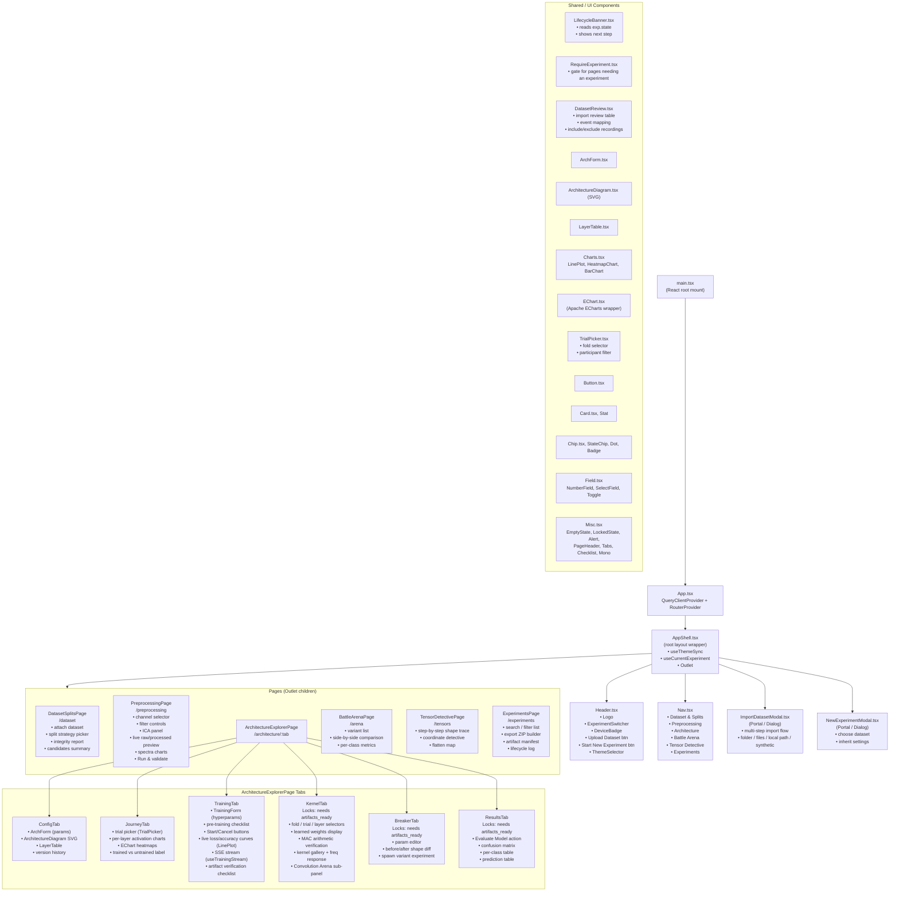

</details>

### Key design decisions

| Area | Decision | Rationale |
|---|---|---|
| **State machine** | 16 states, backend-owned, `TRANSITIONS` map | Prevents UI from lying about what's available |
| **Training gate** | 8-check `verify_and_update()` | Ensures no fake learned-weight displays |
| **Worker thread** | Single `JobManager` with `queue.Queue` | API stays responsive; cancellation via `threading.Event` |
| **SSE vs WebSocket** | SSE (`text/event-stream`) | One-way progress: simpler, works through proxies |
| **TanStack Query** | `refetchInterval: 1500ms when busy` | Experiment state stays in sync without SSE for non-training states |
| **EpochSet** | Memory-mapped numpy arrays | Large datasets never fully in RAM |
| **Preprocessing fingerprint** | SHA-256 of `PreprocessingConfig` JSON | Cache invalidation without DB queries |
| **ICA across folds** | Spatial-pattern correlation matching | Avoids fitting ICA inside the fold loop (expensive) |
| **Architecture immutability** | Editing creates `v2`, original locked | Trained experiments never mutated |
| **Leakage guards** | `_fold_data()` has explicit set-intersection checks | Runtime assertion, not just convention |
| **Synthetic data** | Labelled **SYNTHETIC** everywhere | Cannot be mistaken for real results |
| **Local-only binding** | `127.0.0.1` default; EEG never sent externally | Privacy-first design |


## The workflow

1. Click **Start new experiment** in the header. Choose the current dataset, an imported one, or *Import another
   dataset* (see [Importing datasets](#importing-datasets)). Earlier experiments are never modified. Settings reused from another experiment are listed under
   **Inherited settings** and must be confirmed again.
2. **Dataset & Splits:** attach the dataset, review the summary, pick a split strategy, click **Preview split &
   integrity**, then **Confirm split**.
3. **Preprocessing Studio:** adjust the stages while the preview updates live, then **Run & validate pipeline**. This
   produces the final `[N, 1, C, T]` tensor and validates it.
4. **Architecture Explorer → Architecture Configuration:** choose EEGNet-8,2 or a custom configuration and **Validate &
   save**.
5. **EEG Signal Journey:** follow a trial through the untrained network (clearly labelled) to understand the shapes.
6. **Training Simulator:** set the hyperparameters and **Start training**. Progress streams live. When training
   finishes, the backend verifies the artifacts.
7. **Results & Predictions → Evaluate model**, then explore the **Kernel & Convolution Playground** and the
   **Architecture Breaker**.

The banner at the top of each workflow page shows the backend's lifecycle state and the next required step.

### Workflow at a glance

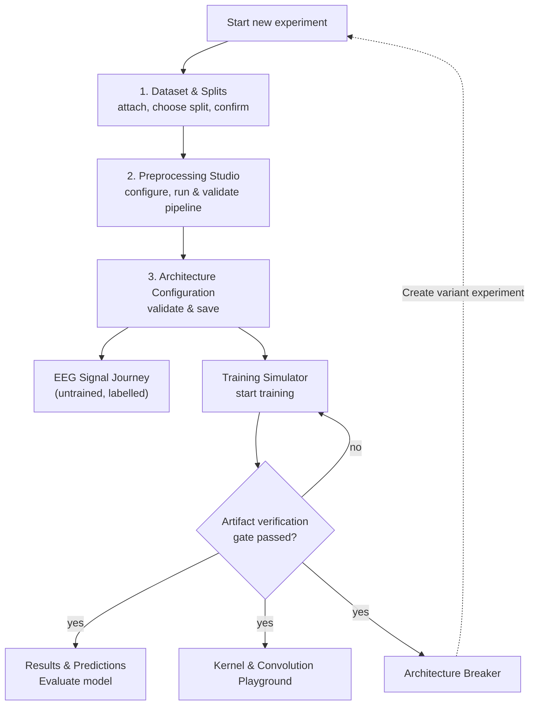

### Experiment lifecycle

The backend owns the lifecycle state machine; the UI only reflects the state it reports. Any change to an upstream setting after training rolls the experiment back and marks the run stale.

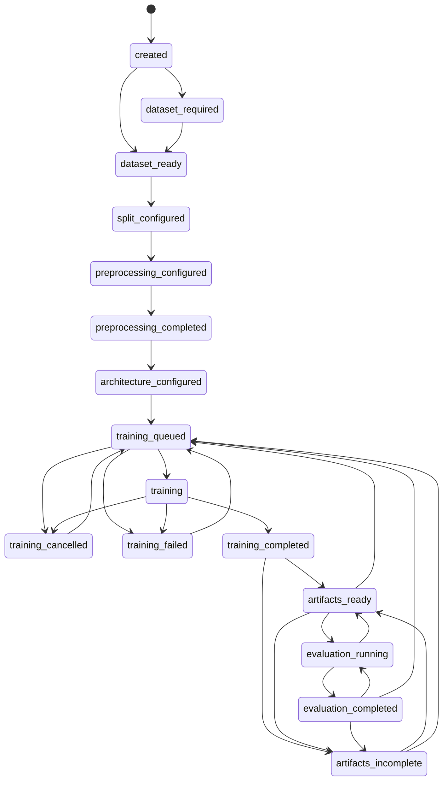


## Importing datasets

Use **Upload dataset** in the header (or *Import another dataset* when starting an experiment). The dialog offers three
ways to bring in a study, plus generated synthetic data:

| Method | What happens |
|---|---|
| **Select dataset folder** | Pick the study's top folder in the browser. The app plans the import from file names first and uploads **only files that can contribute** (recordings, event files, companions, metadata). Images, hidden folders and other files are listed as ignored and never sent. |
| **Select multiple files** | Pick individual files (e.g. a few EDFs and their `_events.tsv`). They are scanned exactly like a folder. |
| **Use local folder path** | Type the folder's path on this computer. The backend reads the folder in place (read-only) and copies nothing until you import. See *Local path safety* below. |
| Synthetic test data | Generated, explicitly labelled **SYNTHETIC** motor-imagery-like data for testing. |

### Import flow

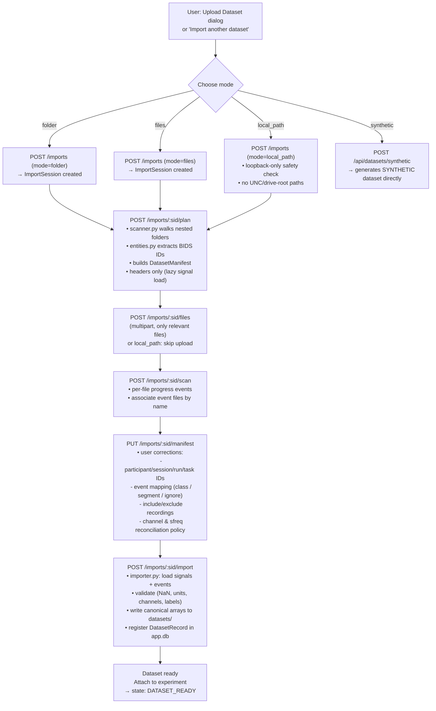

### Scanning

The scan walks nested folders (any depth) and builds a **dataset manifest**, the single description of the dataset
that every later screen uses.

- **Recordings, not files, not trials.** Each EEG file is one recording. A participant can have many recordings
  (sessions, runs, tasks). A continuous recording is never treated as one trial, and event files are never counted
  as recordings.
- **Participant, session, run, task** come from BIDS-style names and folders (`sub-01/ses-02/eeg/sub-01_ses-02_task-mi_run-3_eeg.edf`)
  and from common patterns (`S001R04`, `subject_3`, `P07`, `session2`, `run_1`). If only folders are informative,
  the folder level that separates recordings is used. The review shows where each ID came from.
- **Event files are associated with their recording** by name (`…_events.tsv`, `…-eve.fif`, `…_markers.csv` next to or
  under the recording's folder). Event tables need an onset column (`onset` in seconds, `sample`/`latency` in samples,
  or `onset_ms`) and a description column (`trial_type`, `label`, `value`, `event`, …); `duration` is used when present.
  Otherwise events come from EDF+/BDF annotations, a stim channel, or a `marker` column.
- **Metadata:** `participants.tsv` attributes, `_channels.tsv` (bad channels, channel types),
  `_eeg.json` (e.g. power-line frequency) and `dataset_description.json` (dataset name) are read when present.
- **Large studies:** only headers are read during the scan (signals are loaded lazily at import), and progress is
  reported per file.
- **Privacy:** EDF header identity fields (patient name, birth date, etc.) are never read or stored.

### Dataset Review

Before anything is imported, the review shows participants, recordings, sampling rates, channels, event and label
status, and warnings. All counts update as you edit:

- correct the **participant / session / run / task** of any recording;
- **include or exclude** recordings (unreadable recordings and recordings without events are excluded, with the reason);
- map each raw event to an action in **Event mapping**:

  | Action | Meaning |
  |---|---|
  | Class (event onset) | One trial per marker, labelled with the class you choose. |
  | Segment start / end | Block designs: a start marker opens a block that the matching end marker (same name without "start/end") closes. Each block becomes one trial with its duration. |
  | Ignore | Never becomes a trial (e.g. timestamps, noise markers). |

  Wildcard rules (`FC-* start` → segment start of class `FC`) update many events at once. Sensible defaults are
  suggested: obvious noise markers are ignored and start/end pairs are recognised;
- choose how channels and sampling rates are reconciled: **use shared channels** (intersection, consistent order) or
  require identical sets, and **resample to one rate** or require identical rates. Non-EEG channels (ECG, EMG, EOG,
  references) are inferred from their names, imported, and left out of the model input by default.

Blocking problems (no classes, fewer than two classes, nothing included) disable the **Import** button and are listed
under *Fix before importing*. Imported datasets keep their manifest; **Revise import** on the Dataset page reopens the
review. A revised dataset is a **new** dataset: experiments that used the old one are marked stale, and no earlier
experiment or result is overwritten.

### Local path safety

The local-path option only accepts requests from this computer (loopback). The path must be an existing, absolute
folder. Network (UNC) paths, drive roots and the app's own data store are rejected. Set `EEGNET_IMPORT_ROOTS` to limit
imports to specific folders. The server never lists or returns other filesystem paths; the review shows paths relative
to the chosen folder.

### Formats

All files are checked before they are accepted: channel names, sampling rate, non-finite values, labels or events,
class counts and unit sanity. Uploads are written under sanitized names; only known extensions are accepted.

| Format | Extensions | Structure | Requirements |
|---|---|---|---|
| EDF / EDF+ / BDF / GDF | `.edf`, `.bdf`, `.gdf` | continuous | One file per recording. Events come from annotations (with durations), a BDF `Status` channel, or a separate event file. Annotations starting with `BAD` mark noisy segments. |
| BrainVision | `.vhdr` (+ `.vmrk`, `.eeg`) | continuous | Select or keep the three files together; markers come from the `.vmrk`. |
| Event files | `*_events.tsv`, `*_events.csv`, `*-eve.fif`, `.eve` | — | Associated with the recording of the same name; never counted as recordings. |
| FIF (MNE) | `.fif`, `.fif.gz` | continuous or epoched | Raw: annotations or a stim channel. Epochs (`*-epo.fif`): event codes are the labels; `epochs.metadata` may hold `participant`/`session`. |
| EEGLAB | `.set` (+ `.fdt`) | continuous or epoched | Upload the `.set` together with its companion `.fdt` when the data are stored separately. |
| NumPy | `.npz` | epoched or continuous | Keys: `X` `[trials, channels, samples]` + `y` (epoched), or `X` `[channels, samples]` + optional `events` `[n, 2]` (continuous). Optional: `sfreq`, `ch_names`, `groups`, `sessions`, `class_names`, `tmin`, `unit`. |
| NumPy | `.npy` | epoched or continuous | One data array plus companion arrays recognised by file name: `labels.npy` / `y.npy` (required for epoched data), `groups.npy` / `*subject*.npy`, `sessions.npy`, `events.npy`. |
| CSV / TSV | `.csv`, `.tsv` | epoched or continuous | **Epoched (long format):** `trial`, `label`, optional `participant`, `session`, `time` (s), then one numeric column per channel; every trial has the same number of rows. **Continuous:** one column per channel, optional `time` (s) and `marker` (non-empty / non-zero = event label). |

**Metadata you can enter in the review:** dataset name; for NumPy/CSV data, the sampling rate (required when the
files do not contain it) and unit (µV / mV / V / nV / unknown; MNE formats are converted from volts automatically);
and the participant / session / run / task of every recording, pre-filled from the file and folder names.

- **Participant IDs** are needed for participant-level splits, group-wise K-fold and overlap reports. Without them,
  only trial-level splits are offered and the summary says so.
- **Continuous data without event markers** can be inspected but not trained on. Trial boundaries are never invented.
- **Separate training/test datasets:** choose *Separate training & test datasets* in Dataset & Splits. Channels,
  order, sampling rate, units, epoch length, classes and participant/session overlap are checked between the two.

**Synthetic data:** *Upload dataset → Synthetic test data* generates labelled SYNTHETIC motor-imagery-like data
(mu/beta desynchronisation over C3/C4/Cz, pink noise, line noise, blinks on Fp1/Fp2, occasional spikes).


## Configuring preprocessing

The pipeline runs in a fixed, documented order. Continuous data go through channels → notch → filter → resample →
epoch → baseline → rejection → *ICA* → *normalisation*. Already-epoched data use crop in place of epoch.

```mermaid
flowchart LR
    RAW["Raw EEG recordings<br/>(EpochSet from cache or run_pipeline)"]
    RAW --> CH["Channels<br/>• include/exclude<br/>• mark bad<br/>• rename/map"]
    CH --> NOTCH["Notch filter<br/>50/60 Hz<br/>(continuous only)"]
    NOTCH --> FILT["Band-pass / High-pass / Low-pass<br/>FIR (firwin) or IIR Butterworth<br/>phase: zero / minimum / causal"]
    FILT --> RESAMP["Polyphase resampling<br/>anti-alias FIR<br/>updated time axes"]
    RESAMP --> EPOCH["Epoching<br/>• Fixed window at event markers<br/>• Sliding windows in segments<br/>(whole segment stays in one partition)"]
    EPOCH --> BASE["Baseline correction<br/>• window inside epoch"]
    BASE --> REJECT["Artifact rejection<br/>• BAD segment annotations<br/>• peak-to-peak amplitude<br/>• flat-signal threshold<br/>(rule-based: no fitting → all partitions)"]
    REJECT --> ICA["ICA (optional)<br/>• FastICA / Infomax<br/>• fitted on TRAINING partition only<br/>• large sets: seeded subset ~25M samples<br/>• cross-fold: spatial correlation matching"]
    ICA --> NORM["Normalization<br/>• per-channel z-score<br/>• robust (median/IQR)<br/>• global z-score<br/>• per-trial z-score<br/>• fitted on TRAINING, applied to val/test"]
    NORM --> TENSOR["Final tensor [N, 1, C, T]<br/>written to cache/preprocessed/<br/>keyed by PreprocessingConfig fingerprint"]
```

| Stage | Options | Notes |
|---|---|---|
| Channels | include/exclude, mark bad, rename (mapping) | Bad channels are excluded and recorded (not interpolated). |
| Filtering | band-pass / high-pass / low-pass; FIR (firwin) or IIR Butterworth (order); zero / minimum (FIR) / causal (IIR) phase; 50/60 Hz notch | Cutoffs are validated against Nyquist. Filtering already-epoched data triggers an edge-effect warning. |
| Artifacts | reject epochs overlapping `BAD` annotations; peak-to-peak amplitude threshold; flat-signal threshold; ICA | Rejection is rule-based (no fitting), so it applies to all partitions; each rejected trial is listed with its reason. |
| ICA | number of components (an integer, or a fraction = share of variance), FastICA / Infomax | Fitted on the **training partition only**. Large training sets are fitted on a seeded random subset of training trials (about 25 M channel × sample values, shown as *fitted on N of M*) and cleaned in batches, so ICA does not run out of memory. The panel shows explained variance, kurtosis, frontal correlation (blink proxy), low/high-frequency power, spatial pattern, spectrum and time courses. Explained variance alone does not identify artefacts. |
| Resampling | target rate | Polyphase resampling with an anti-aliasing FIR filter; time axes are updated. |
| Epoching | **Fixed window at each event** (class selection, window start/end) or **sliding windows in segments** (window length, step, skip at segment start, max windows per segment) | Out-of-bounds events are rejected and reported. Sliding windows are used for block designs: every window of a block keeps the block's trial ID (`…:e0003#w012`), and all windows of a block stay in the same split partition. |
| Baseline | window | Must lie inside the epoch. |
| Normalisation | per-channel z-score, robust (median/IQR), global z-score, per-trial z-score, none | Fitted on each fold's training subset and applied unchanged to validation and test data. |

**Run & validate pipeline** checks the final tensor (finite values, at least two classes, no constant channels, split
integrity after rejection, a usable shape). It then fits the learned stages on the training partition for display.
During training, they are refitted inside every fold.

**Large datasets:** preprocessing works one recording at a time and streams the epochs to a memory-mapped file in
`data/cache/preprocessed/`, so the processed data never have to fit in RAM. ICA, normalisation, training and
evaluation read them in chunks, and training moves one mini-batch at a time to the GPU. For a large continuous
dataset the live preview processes a sample of 40 recordings spread over participants, and says so; **Run & validate
pipeline** always processes every recording. Free disk space of about N × C × T × 4 bytes is needed (shown as the
size next to the tensor shape).

**Fixed window or sliding windows:** the *Epoching & classes* stage has one switch between the two, and an
**Applied now** box shows the active mode with the resulting number of epochs and size. *Apply suggestions*
proposes sliding windows only for long blocks (median 6 s or more), otherwise a fixed window at each event.

**ICA across folds:** components selected on the reference fit are matched to each fold's own ICA by spatial-pattern
correlation (|r| ≥ 0.8 by default). Matches and non-matches are recorded in the run.

**Suggested from the dataset:** the studio proposes a starting configuration from the manifest: sliding windows for
start/end segments, a notch at the recorded power-line frequency, bad channels from `_channels.tsv`, and non-EEG
channels left out. **Apply suggestions** copies them into the pipeline; nothing is applied silently. The preview also
reports candidates, kept trials and windows per participant and per recording.


## Split strategies and what they measure

| Strategy | Question it answers |
|---|---|
| **Random trial-level hold-out** (ratio, stratification, seed) | How well does the model classify *new trials from participants it has seen*? Participants appear in both sets; the overlap report shows this. |
| **Participant-level hold-out** (pick participants or a random count) | How well does it generalise to *unseen participants*? Zero overlap is verified by the backend. |
| **K-fold:** trial-wise, stratified trial-wise, group-wise (`GroupKFold`), stratified group-wise (`StratifiedGroupKFold`) | The same two questions, averaged over K disjoint test folds; every trial is tested exactly once. |
| **Separate datasets** | Whatever the two datasets imply. If participants or sessions overlap, this measures within-participant (e.g. cross-session) generalisation, and a warning says so. |

Splits are computed over **candidate trial IDs** (epochs, event markers, or start/end segments in continuous data).
Assignments therefore survive epoch rejection and are stored with a fingerprint and seed so they can be reproduced.
Candidate IDs include the recording (`sub-01_ses-01_task-mi_run-2:e0007`), and the participant groups come from the
dataset manifest, so group splits keep every recording of a participant together. With sliding windows, the split
assigns whole segments, never single windows. The integrity report is recomputed whenever the dataset or its
manifest changes.


## Training and cross-validation

The **Training Simulator** controls:

- epochs, batch size, learning rate;
- optimizer (Adam / AdamW / SGD + momentum), weight decay, cross-entropy with optional label smoothing;
- seed, device (auto / CPU / CUDA), class weighting;
- the validation strategy (auto / stratified / random / group-wise / none) and validation fraction;
- early stopping (patience, monitor), restore-best-epoch;
- LR schedule (step, cosine, reduce-on-plateau);
- the number of representative trials whose activations are saved.

- **Pre-training checks** run before every training run and block it if one fails:
  - the attached datasets are available and their recordings are compatible (channels, sampling rate);
  - every included recording has events, and the class mapping yields at least two classes;
  - split integrity holds after preprocessing (no participant overlap for group protocols);
  - the processed data are current for the attached datasets;
  - the model input matches the processed tensor and class count.
- Training runs in a **background worker**, so the API stays responsive. Progress (loss, accuracy, validation balanced
  accuracy, learning rate, elapsed time, device) streams over **Server-Sent Events** straight from the training loop.
- **Cancel** stops the run between mini-batches. Failed and cancelled runs never unlock learned-model tools.
- For **K-fold**, one model is trained per fold. Each fold gets its own validation subset (from that fold's training
  part), its own fitted ICA/normalisation and its own checkpoint. Evaluation pools out-of-fold predictions and also
  reports the mean ± SD across folds.
- After training, the run is verified automatically. The checklist is shown in the Training Simulator. If a file is
  missing or corrupted, it reports exactly what failed and offers **Re-verify** (after restoring the file) or a retrain.
- **Resuming** an interrupted run is not supported. A run interrupted by a server restart is marked failed on the
  next start-up, and you retry with a new run.

### Training execution flow

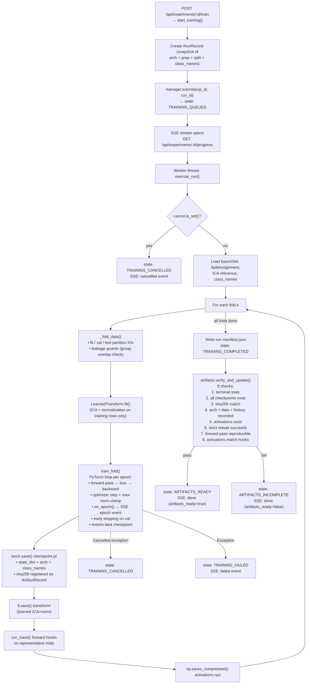

### Artifact verification gate

Kernel inspection, the Architecture Breaker and evaluation unlock only when every check passes.

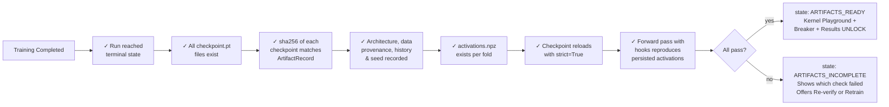


## Inspecting a trained model

### EEGNet architecture (as built)

Every tool below inspects this network. Layer sizes, kernel lengths, pooling and activation are configurable; the diagram shows the structure.

```mermaid
flowchart TD
    INPUT["Input: [B, 1, C, T]<br/>e.g. [32, 1, 22, 256]"]
    INPUT --> TConv["Temporal Conv2d<br/>• [1 → F1] × (1, temporal_kernel)<br/>• padding='same' or 'valid'<br/>• no bias<br/>• groups=1"]
    TConv --> BN1["BatchNorm2d(F1)<br/>• momentum, eps configurable"]
    BN1 --> SConv["Depthwise Spatial Conv2d<br/>• [F1 → F1×D] × (C, 1)<br/>• groups=F1 (one kernel per channel)<br/>• max_norm on weights<br/>• no bias"]
    SConv --> BN2["BatchNorm2d(F1×D)"]
    BN2 --> ACT1["Activation<br/>(ELU / ReLU / GELU / SiLU)"]
    ACT1 --> POOL1["AvgPool2d / MaxPool2d<br/>× (1, pool1_kernel)<br/>stride = pool1_stride"]
    POOL1 --> DROP1["Dropout / SpatialDropout2d<br/>p = dropout"]
    DROP1 --> DWConv["Separable: Depthwise Temporal Conv2d<br/>• [F1×D → F1×D] × (1, separable_kernel)<br/>• groups = F1×D<br/>• padding='same' or 'valid'"]
    DWConv --> PWConv["Separable: Pointwise Conv2d<br/>• [F1×D → F2] × (1, 1)<br/>• groups = 1"]
    PWConv --> BN3["BatchNorm2d(F2)"]
    BN3 --> ACT2["Activation"]
    ACT2 --> POOL2["AvgPool2d / MaxPool2d<br/>× (1, pool2_kernel)<br/>stride = pool2_stride"]
    POOL2 --> DROP2["Dropout"]
    DROP2 --> FLAT["Flatten<br/>→ [B, F2 × T_out]"]
    FLAT --> CLS["Linear classifier<br/>[F2 × T_out → n_classes]<br/>• max_norm on weights<br/>• no bias"]
    CLS --> LOGITS["Logits → Softmax → Probabilities"]
```

### Inspection tools

- **EEG Signal Journey:** the uploaded signal, processed epoch, model input, every layer's activations (labelled as
  activations, not voltages) and the logits/probabilities for any trial. It uses the trained checkpoint, or an
  explicitly labelled untrained initialisation before training.
- **Kernel & Convolution Playground:** choose a checkpoint (fold), trial, layer, feature map, row and position. The
  page shows the input window (including padded zeros), the learned weights, the element-wise products and the sum,
  and checks that sum against the hooked activation. Pooling, BatchNorm, activation, dropout, flatten and the
  classifier each show their actual operation. A second trial can be compared, and the **Kernel gallery** shows
  temporal kernels with their frequency responses, spatial filters, the pointwise matrix and classifier weights.
- **Convolution Arena:** the model's depthwise spatial convolution (group mapping, weights, inputs and outputs) and its
  separable convolution (depthwise temporal step, then pointwise mixing), with parameter counts and shape changes. A
  stride/padding demonstration applies a learned kernel outside the model and is clearly labelled as such.
- **Architecture Breaker:** edit any parameter and see:
  - the before/after shapes, parameters, MACs, memory and receptive field;
  - per-tensor weight compatibility;
  - whether the checkpoint still applies. Only training-time or display changes keep it valid; for those, the learned
    outputs are shown.

  Incompatible variants never show learned activations or accuracy. Use **Create variant experiment** to train one
  under the same split and preprocessing.
- **Tensor Detective:** a step-by-step shape trace with the output-size formulas. It maps any coordinate back to the
  input samples and channels it depends on, and shows how flattening indexes the classifier input. It works for the
  current configuration, a trained checkpoint, or any custom configuration.
- **Results & Predictions:** test metrics, the confusion matrix and per-class scores, plus **held-out results by
  participant**. Every prediction lists its participant, run and recording. With sliding windows, a per-segment
  summary (window probabilities averaged per segment) is shown next to the per-window metrics.
- **Trial pickers** across the app (Journey, Kernel Playground, Preprocessing preview) filter by participant and
  partition and show each trial's participant and run.


## Comparing experiments

In the **Hyperparameter Battle Arena**:

1. **Create a variant** from a base experiment. It inherits the same dataset, split assignment and preprocessing, so
   the protocol is matched.
2. **Train** and **Evaluate** it from the list.
3. Select two or more experiments to compare.

The comparison shows architectures, parameter counts, shapes, training time and device, preprocessing and split
fingerprints, validation curves, final test metrics, confusion matrices, per-class F1 and prediction disagreement.
Disagreement is computed only when the test trials and protocol are identical. Warnings appear when datasets, class
mappings, preprocessing or protocols differ. Configurations are ranked by **validation** balanced accuracy; test
metrics are labelled *final* and should not be used to choose hyperparameters.


## Exporting results

In **Experiments & Exports**, select an experiment and tick what to include. The ZIP always contains a
`manifest.json` listing every file with its sha256 and provenance.

| Item | Files |
|---|---|
| Model / training / preprocessing configuration | `config/*.json` (preprocessing includes the processing report and per-fold learned-stage fit reports) |
| Split manifest | `splits/split_manifest.json`: protocol, seed, fingerprint, test assignments and per-fold train/validation/test IDs |
| Metrics | `results/metrics.json`, `results/metrics.csv` |
| Predictions | `results/predictions.csv` (trial, parent trial, fold, participant, session, run, recording, true/predicted label, per-class probabilities, checkpoint) |
| Dataset manifest | `dataset/<dataset id>_manifest.json`: participants, recordings, event mapping, channel and rate policies used for the import |
| Trial provenance | `splits/trial_provenance.csv`: one row per candidate trial with dataset, participant, session, run, recording, source file, label, onset, duration, preprocessing outcome (kept / rejection reason), number of model rows (windows) and its partition in every fold |
| History | `results/training_history.csv` / `.json` |
| Confusion matrix | `results/confusion_matrix.csv` |
| Plots | `plots/*.png` and `plots/*.svg` |
| Checkpoints | `checkpoints/fold<k>_<id>.pt` (PyTorch `state_dict` + architecture + class names; loads with `weights_only=True`) |
| Report | `report.html`, a self-contained HTML report |

Raw EEG data are **never** included in bundles. **Export dataset (explicit)** downloads a dataset's canonical arrays
separately. Every chart in the UI also has a *Save as PNG* button.


---

## API overview

Typed (Pydantic) routes under `/api`:

| Group | Routes |
|---|---|
| System | `GET /health`, `GET /meta/formats`, `GET /meta/lifecycle` |
| Imports | `POST /imports` (mode `folder` / `files` / `local_path`), `GET /imports/{sid}`, `POST /imports/{sid}/plan`, `POST /imports/{sid}/files`, `POST /imports/{sid}/scan`, `PUT /imports/{sid}/manifest`, `POST /imports/{sid}/import`, `DELETE /imports/{sid}` |
| Datasets | `GET/POST /datasets` (`/upload`, `/synthetic`), `GET /datasets/{id}`, `/trials`, `/signal`, `/manifest`, `POST /datasets/{id}/revise`, `/compatibility/{other}`, `/export`, `DELETE` |
| Models | `GET /models/presets`, `POST /models/validate`, `POST /models/coordinate`, library `GET/POST /models/configs`, `/duplicate`, `DELETE` |
| Experiments | `GET/POST /experiments`, `GET/PATCH/DELETE /experiments/{id}`, `/duplicate`, `/variants`, `/events`, `POST /experiments/compare` |
| Dataset & split | `PUT /{id}/dataset`, `GET /{id}/candidates`, `POST /{id}/split/preview`, `PUT/GET /{id}/split` |
| Preprocessing | `POST /{id}/preprocessing/validate`, `/preview`, `PUT /{id}/preprocessing`, `POST /{id}/preprocessing/run`, `POST/GET /{id}/preprocessing/ica` |
| Architecture | `GET/PUT /{id}/architecture`, `PUT /{id}/training-config` |
| Training | `POST /{id}/train`, `GET /{id}/progress` (SSE), `POST /{id}/cancel`, `GET /{id}/runs[/{run}]` |
| Artifacts | `GET /{id}/artifacts`, `POST /{id}/artifacts/verify`, `GET /{id}/checkpoints/{ckpt}/download` |
| Inspection | `GET /{id}/trials`, `GET /{id}/journey`, `GET /{id}/kernels`, `POST /{id}/convolution`, `POST /{id}/arena`, `POST /{id}/breaker`, `POST /{id}/breaker/spawn` |
| Results | `POST /{id}/evaluate`, `GET /{id}/results`, `GET /{id}/predictions` |
| Export | `GET /{id}/export/items`, `POST /{id}/export`, `GET /exports/{eid}[/download]` |

Lifecycle conflicts return **409**, invalid configurations **422**, and unknown IDs **404**. The artifact manifest
uses relative storage keys; filesystem paths are never exposed.

<details>
<summary><b>Which page or component calls which endpoint</b> (click to expand)</summary>

```mermaid
flowchart TD
    subgraph FE["Frontend Portals (HTTP calls)"]
        direction TB

        H1["GET /api/health"]
        H2["GET /api/meta/formats"]
        H3["GET /api/meta/lifecycle"]

        D1["GET /api/datasets"]
        D2["GET /api/datasets/:id"]
        D3["GET /api/datasets/:id/trials"]
        D4["GET /api/datasets/:id/signal"]
        D5["GET /api/datasets/:id/manifest"]
        D6["POST /api/datasets/:id/revise"]
        D7["GET /api/datasets/:id/compatibility/:other"]
        D8["POST /api/datasets/synthetic"]
        D9["DELETE /api/datasets/:id"]

        I1["POST /api/imports<br/>(mode: folder|files|local_path)"]
        I2["GET /api/imports/:sid"]
        I3["POST /api/imports/:sid/plan"]
        I4["POST /api/imports/:sid/files<br/>(multipart upload)"]
        I5["POST /api/imports/:sid/scan"]
        I6["PUT /api/imports/:sid/manifest<br/>(event mapping, corrections)"]
        I7["POST /api/imports/:sid/import"]
        I8["DELETE /api/imports/:sid"]

        M1["GET /api/models/presets"]
        M2["POST /api/models/validate"]
        M3["POST /api/models/coordinate"]
        M4["GET/POST /api/models/configs"]

        E1["GET /api/experiments"]
        E2["POST /api/experiments"]
        E3["GET /api/experiments/:id"]
        E4["PATCH /api/experiments/:id"]
        E5["POST /api/experiments/:id/duplicate"]
        E6["POST /api/experiments/:id/variants"]
        E7["DELETE /api/experiments/:id"]
        E8["GET /api/experiments/:id/events"]

        S1["PUT /api/experiments/:id/dataset"]
        S2["GET /api/experiments/:id/candidates"]
        S3["POST /api/experiments/:id/split/preview"]
        S4["PUT /api/experiments/:id/split"]
        S5["GET /api/experiments/:id/split"]

        P1["POST /api/experiments/:id/preprocessing/validate"]
        P2["POST /api/experiments/:id/preprocessing/preview"]
        P3["PUT /api/experiments/:id/preprocessing"]
        P4["POST /api/experiments/:id/preprocessing/run"]
        P5["POST /api/experiments/:id/preprocessing/ica"]
        P6["GET /api/experiments/:id/preprocessing/ica"]
        P7["GET /api/experiments/:id/preprocessing/defaults"]

        A1["GET /api/experiments/:id/architecture"]
        A2["PUT /api/experiments/:id/architecture"]
        A3["PUT /api/experiments/:id/training-config"]

        T1["POST /api/experiments/:id/train"]
        T2["GET /api/experiments/:id/progress (SSE)"]
        T3["POST /api/experiments/:id/cancel"]
        T4["GET /api/experiments/:id/runs"]
        T5["GET /api/experiments/:id/runs/:runId"]

        ART1["GET /api/experiments/:id/artifacts"]
        ART2["POST /api/experiments/:id/artifacts/verify"]
        ART3["GET /api/experiments/:id/checkpoints/:ckpt/download"]

        INS1["GET /api/experiments/:id/trials"]
        INS2["GET /api/experiments/:id/journey"]
        INS3["GET /api/experiments/:id/kernels"]
        INS4["POST /api/experiments/:id/convolution"]
        INS5["POST /api/experiments/:id/arena"]
        INS6["POST /api/experiments/:id/breaker"]
        INS7["POST /api/experiments/:id/breaker/spawn"]
        INS8["GET /api/experiments/:id/pretraining-checks"]

        R1["POST /api/experiments/:id/evaluate"]
        R2["GET /api/experiments/:id/results"]
        R3["GET /api/experiments/:id/predictions"]

        X1["GET /api/experiments/:id/export/items"]
        X2["POST /api/experiments/:id/export"]
        X3["GET /api/exports/:eid"]
        X4["GET /api/exports/:eid/download"]
        X5["POST /api/experiments/compare"]
    end

    subgraph PageMap["Page / Component that calls each group"]
        Header --> H1
        ImportDatasetModal --> I1
        ImportDatasetModal --> I2
        ImportDatasetModal --> I3
        ImportDatasetModal --> I4
        ImportDatasetModal --> I5
        ImportDatasetModal --> I6
        ImportDatasetModal --> I7
        DatasetReview --> D6
        DatasetSplitsPage --> D1
        DatasetSplitsPage --> D2
        DatasetSplitsPage --> S1
        DatasetSplitsPage --> S2
        DatasetSplitsPage --> S3
        DatasetSplitsPage --> S4
        DatasetSplitsPage --> S5
        PreprocessingPage --> P1
        PreprocessingPage --> P2
        PreprocessingPage --> P3
        PreprocessingPage --> P4
        PreprocessingPage --> P5
        PreprocessingPage --> P6
        PreprocessingPage --> P7
        ConfigTab --> A1
        ConfigTab --> A2
        ConfigTab --> M2
        TrainingTab --> T1
        TrainingTab --> T2
        TrainingTab --> T3
        TrainingTab --> ART1
        TrainingTab --> ART2
        TrainingTab --> INS8
        JourneyTab --> INS1
        JourneyTab --> INS2
        KernelTab --> INS1
        KernelTab --> INS3
        KernelTab --> INS4
        KernelTab --> INS5
        BreakerTab --> INS6
        BreakerTab --> INS7
        ResultsTab --> R1
        ResultsTab --> R2
        ResultsTab --> R3
        BattleArenaPage --> E5
        BattleArenaPage --> E6
        BattleArenaPage --> X5
        TensorDetectivePage --> M3
        TensorDetectivePage --> A1
        ExperimentsPage --> E1
        ExperimentsPage --> E3
        ExperimentsPage --> E4
        ExperimentsPage --> E5
        ExperimentsPage --> E7
        ExperimentsPage --> X1
        ExperimentsPage --> X2
        ExperimentsPage --> X3
        ExperimentsPage --> X4
        NewExperimentModal --> E2
        NewExperimentModal --> E1
    end
```

</details>


## Scientific limitations and known constraints

- **Synthetic data are for software testing.** The generator's class effects are strong, so models reach very high
  accuracy on it. That says nothing about real EEG decoding performance.
- **Model selection uses one validation subset** per fold. Nested cross-validation is not implemented. For honest
  hyperparameter search, rank by validation metrics (as the Battle Arena does) and treat test metrics as final.
- **Rule-based rejection** (amplitude, flat, BAD segments) is applied to every partition because it has no fitted
  parameters. This changes which test trials are evaluated; the rejected IDs are reported.
- **Bad channels are excluded, not interpolated** (no electrode positions are required).
- **Event mapping is per task**, not per recording: the same marker text maps to the same class in every recording of
  a task. Exclude a recording, or give it a different task, if it uses markers differently.
- **Sliding windows overlap** when the step is shorter than the window. Windows of one segment are never split across
  partitions, but per-window metrics are not independent samples; the per-segment summary (window probabilities
  averaged per segment) is reported next to them.
- **Revise import** reuses the original scan and re-reads the original files on import: the staged copies of a
  folder/file import are kept for this, and for a local-path import the original folder must still exist.
- **ICA component selection across folds** relies on spatial-pattern matching. A component without a match above the
  threshold is *not* removed in that fold, and this is recorded. ICA patterns are shown as channel bar charts, not
  scalp topographies.
- **Filtering epoched data** can cause edge artefacts; filter continuous data when available.
- **Training cannot be resumed** after interruption, and one run trains at a time (others queue).
- **Determinism:** seeds are fixed and cuDNN is set to deterministic, but GPU and CPU results can still differ slightly.
- **Reports** are HTML only (no PDF). Plot exports in bundles are PNG and SVG; UI charts export PNG.
- The ROC-AUC and average precision are **undefined** when a class is missing from the evaluated trials. The app
  reports this instead of a number. Balanced accuracy averages recall over the classes present.

